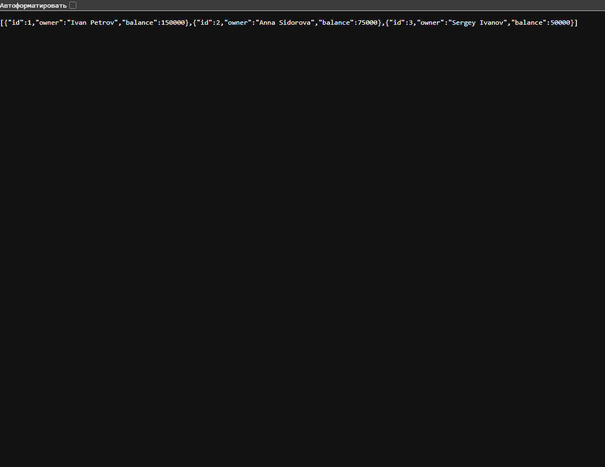

# Лабораторная работа 08 — версии API банковских счетов

## Краткий отчёт

Создан Bank Account API на ASP.NET Core. Две версии используют общий список счетов, но возвращают данные в разных форматах.

## Выполнение по заданию

### 1. Общие данные

В `Models/BankAccount.cs` описан банковский счет. `AccountService` хранит три счета в памяти и зарегистрирован через внедрение зависимостей.

### 2. Версия v1

В `Controllers/V1/AccountsController.cs` реализованы получение списка и поиск по ID. Ответ содержит `id`, `owner`, `balance`.

### 3. Версия v2

В `Controllers/V2/AccountsController.cs` реализованы список, поиск по ID и сводка. Ответ содержит `id`, `ownerName`, `balance`, `currency`, `status`.

### 4. Проверка

| Запрос | Результат |
|---|---|
| `GET /api/v1/accounts` | 200, список в формате v1 |
| `GET /api/v2/accounts` | 200, список в формате v2 |
| `GET /api/v1/accounts/1` | 200, поле `owner` |
| `GET /api/v2/accounts/1` | 200, поле `ownerName` |
| `GET /api/v2/accounts/summary` | 200, 3 счета и общий баланс 275000 |
| `GET /api/v1/accounts/summary` | 404 |
| `GET /api/v2/accounts/999` | 404 |
| `GET /api/v3/accounts` | 404 |

## Запуск

Откройте PowerShell в этой папке и выполните:

```powershell
& "$env:LOCALAPPDATA\Programs\dotnet-sdk\dotnet.exe" run --urls http://localhost:5088
```

Откройте в браузере `http://localhost:5088/api/v1/accounts` и `http://localhost:5088/api/v2/accounts`. Для завершения нажмите Ctrl+C в терминале. На другом компьютере с установленным .NET SDK 10 можно использовать `dotnet run --urls http://localhost:5088`.

## Скриншот выполнения



## Вывод

Две версии API используют одни счета, но у каждой свой DTO. Поэтому изменение полей версии v2 не меняет ответ v1.
